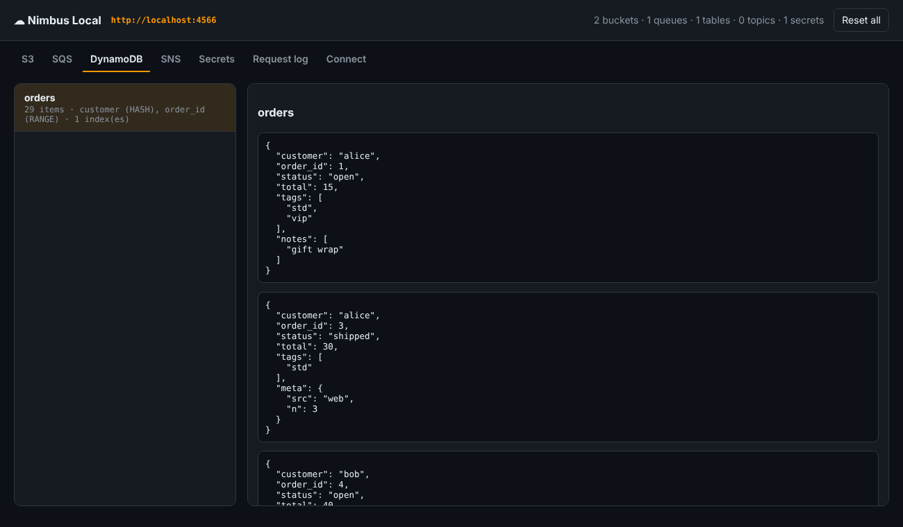
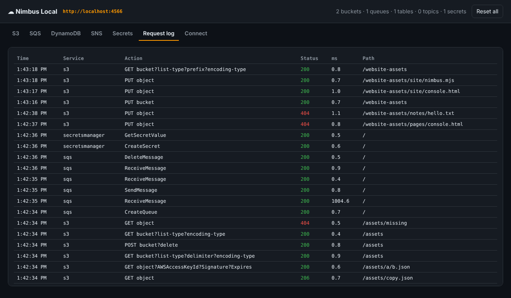

<div align="center">

# ☁️ Nimbus Local

### A zero-dependency AWS emulator for local development and CI.

**S3 · SQS · DynamoDB · SNS · Secrets Manager · STS** on one port. Starts in about 35 ms with roughly 55 MB of memory. Point the AWS CLI, boto3 or any AWS SDK at `http://localhost:4566`. There is no Docker requirement, no account, no auth token and no `npm install`.

[Quick start](#-quick-start) · [What's supported](#-whats-supported) · [Use in CI](#-use-in-ci) · [Console](#-web-console) · [Use cases](#-use-cases)



</div>

---

## Why Nimbus?

Integration tests against AWS are slow, flaky and cost money, and full emulators can be heavy to run. Nimbus is a tiny, readable emulator (about 1.6k lines of plain Node.js) for the services most apps touch every day. It speaks the real wire protocols, so your code needs no changes; you only set an endpoint URL.

Inspired by [Floci](https://github.com/floci-io/floci) and [LocalStack](https://github.com/localstack/localstack). Nimbus is an independent, from-scratch implementation focused on **instant startup, zero dependencies and correct behaviour for the common 90%**.

| | |
|---|---|
| ⚡ **Instant** | ready in about 35 ms with about 55 MB RSS, so it's cheap to start per test run |
| 📦 **Zero dependencies** | one `node nimbus.mjs`, or the 1-line Dockerfile |
| 🔌 **Drop-in** | port 4566, `/_localstack/health`, account `000000000000`, the same queue URL style |
| 🧪 **Verified with real clients** | the CI runs the **AWS CLI** and **boto3** against it on every push ([tests](tests/integration_boto3.py)) |
| 🖥 **Web console** | browse buckets, peek queues, view table items and watch a live request log at `/_nimbus` |
| 💾 **Optional persistence** | `--persist ./.nimbus` keeps state between restarts |

## ⚡ Quick start

```bash
git clone https://github.com/mnbresearch/nimbus-local.git && cd nimbus-local
node nimbus.mjs                       # → http://localhost:4566   console: /_nimbus
# or: docker build -t nimbus . && docker run -p 4566:4566 nimbus
```

```bash
export AWS_ENDPOINT_URL=http://localhost:4566 AWS_ACCESS_KEY_ID=test AWS_SECRET_ACCESS_KEY=test AWS_DEFAULT_REGION=us-east-1

aws s3 mb s3://demo && aws s3 cp big-file.zip s3://demo/      # multipart works
aws sqs create-queue --queue-name jobs
aws dynamodb create-table --table-name users \
  --attribute-definitions AttributeName=id,AttributeType=S \
  --key-schema AttributeName=id,KeyType=HASH --billing-mode PAY_PER_REQUEST
aws secretsmanager create-secret --name db/password --secret-string s3cr3t
```

**boto3** `boto3.client("s3", endpoint_url="http://localhost:4566")` · **AWS SDK v3** `new S3Client({ endpoint: "http://localhost:4566", forcePathStyle: true })`

Options: `--port 4566`, `--host 0.0.0.0`, `--persist ./.nimbus`, `--quiet` (or the `NIMBUS_PORT`, `NIMBUS_HOST` and `NIMBUS_PERSIST` env vars).

## ✅ What's supported

**S3:** create, list, head and delete buckets; put, get, head, delete and copy objects (with `REPLACE` metadata); `x-amz-meta-*`; **Range** reads; ListObjects v1/v2 with prefix, delimiter and pagination; DeleteObjects; **multipart upload** (create, upload part, list parts, complete, abort); **presigned URLs**; path-style and virtual-hosted-style; `aws-chunked` / streaming-signature bodies from newer SDKs; versioning flag; harmless stubs for ACL, CORS, policy and tagging.

**SQS:** JSON **and** legacy Query/XML protocols; create, list, get URL, delete and purge; send and send-batch; receive with **visibility timeout, DelaySeconds and long polling**; delete and delete-batch; change visibility; queue attributes; **dead-letter redrive** (`RedrivePolicy`); **FIFO** with message groups and content-based or explicit **deduplication**; tags; correct MD5s, which the SDKs validate.

**DynamoDB:** create, describe, list, update and delete tables with **GSIs and LSIs**; Put, Get, Update and Delete Item; **Query and Scan** with `KeyConditionExpression`, `FilterExpression`, `ProjectionExpression`, `#names`/`:values`, `ScanIndexForward`, `Limit` and `ExclusiveStartKey` pagination, `Select=COUNT`, and parallel scan segments; **ConditionExpression** (`attribute_exists`, `attribute_not_exists`, `begins_with`, `contains`, `size`, `BETWEEN`, `IN`, `AND`/`OR`/`NOT`, nested `a.b[1]` paths); **UpdateExpression** with `SET` (+/−, `if_not_exists`, `list_append`), `REMOVE`, `ADD` and `DELETE`; `ReturnValues`; BatchWrite and BatchGet; **TransactWriteItems** with all-or-nothing rollback and TransactGetItems; **TTL**.

**SNS:** create, list and delete topics; subscribe and unsubscribe; publish with **fan-out to SQS** (envelope or raw delivery) and HTTP endpoints.

**Secrets Manager:** create, get, put, update, describe, list, delete and restore secrets; version stages (`AWSCURRENT` / `AWSPREVIOUS`); GetRandomPassword.

**STS:** GetCallerIdentity, AssumeRole and GetSessionToken.

Not emulated: IAM policy enforcement and request signature verification (any credentials are accepted), and services outside the list above. PRs are welcome.

## 🧪 Use in CI

```yaml
# .github/workflows/test.yml
- uses: actions/checkout@v4
  with: { repository: mnbresearch/nimbus-local, path: .nimbus }
- run: node .nimbus/nimbus.mjs --quiet &
- run: npm test
  env:
    AWS_ENDPOINT_URL: http://localhost:4566
    AWS_ACCESS_KEY_ID: test
    AWS_SECRET_ACCESS_KEY: test
    AWS_REGION: us-east-1
```

Or start it inside a Node test runner: `const { startNimbus } = await import('./nimbus.mjs'); const n = await startNimbus({ port: 0, quiet: true });`. With `port: 0` each test file gets its own isolated instance.

## 🖥 Web console

Open **http://localhost:4566/_nimbus** to:

- browse buckets and download objects
- peek at queues without changing message visibility
- see DynamoDB items as plain JSON
- list secrets and their versions (secret values are never shown)
- watch a **live request log** of every API call, with service, action, status and latency
- copy connection snippets for the CLI, boto3 and SDK v3
- reset all state



## 🧭 Use cases

- **Unit and integration tests** for Lambda handlers, workers and APIs without touching a real AWS account.
- **CI pipelines**: a 35 ms start means each job, or each test file, gets a fresh emulator.
- **Offline development**: work on planes and trains; `--persist` keeps your local data.
- **Teaching and workshops**: students practise S3, SQS and DynamoDB with no credit card and no cost risk.
- **Debugging SDK behaviour**: the request log shows exactly which API calls your code makes.
- **Prototyping event flows**: SNS → SQS fan-out, DLQs and FIFO ordering on your laptop.

## 🧱 Architecture

```
nimbus.mjs              HTTP server: routing by X-Amz-Target / SigV4 scope, body decoding, errors, console API, persistence
services/s3.mjs         REST/XML S3
services/sqs.mjs        SQS (JSON + Query)
services/dynamodb.mjs   DynamoDB tables, items, query/scan, batches, transactions, TTL
services/expressions.mjs  DynamoDB condition / update / projection expression engine
services/misc.mjs       Secrets Manager, SNS, STS
console.html            web console
tests/                  node --test unit tests + boto3 end-to-end suite
```

## License

[MIT](LICENSE) © 2026 Mridul Nanda — [MNB Research](https://github.com/mnbresearch) · Abrobot.ai. Not affiliated with Amazon Web Services.
